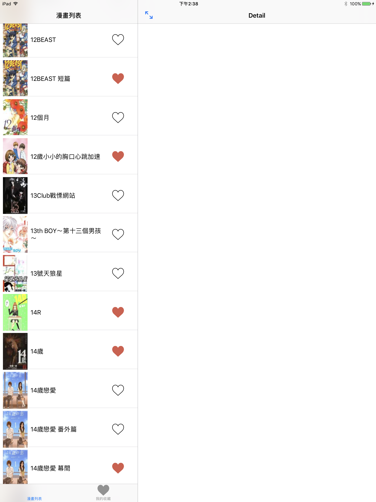
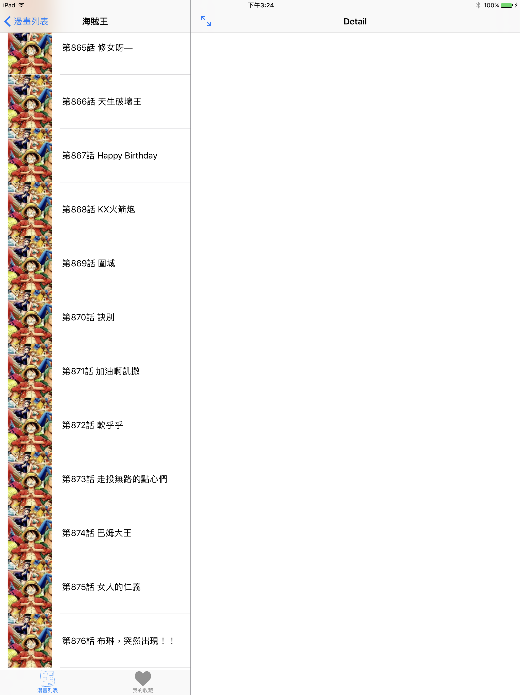
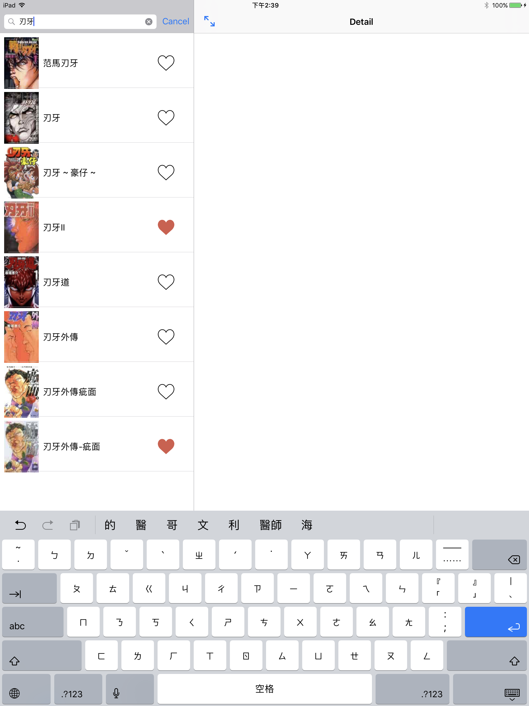
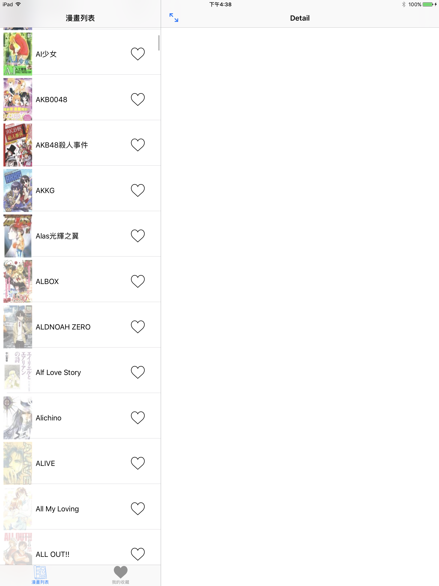

# WLComics
可用iPad、iPhone觀看漫畫的App!無廣告!公開源碼!

1.列出所有的漫畫

2.列出集數

3.搜尋漫畫

4.橫向閱讀

5.直立閱讀

6.圖片快取功能

7.預覽縮圖

## 免責聲明
- 本專案僅供學習與技術研究之用，非商業用途。
- 本 App 不儲存、不上傳、不散佈任何漫畫內容；所有圖片皆即時取自第三方網站，版權歸原作者及出版社所有。
- 本專案與 8comic（無限動漫）及任何漫畫版權方皆無關聯。
- 離線下載功能僅供個人於裝置上閱讀，請勿再散佈。
- 若您是版權持有人且認為本專案侵害您的權益，請透過 [GitHub Issue](https://github.com/WebberLai/WLComics/issues) 聯繫，將儘速處理。
- 第三方網站改版可能造成功能失效，本專案不保證可用性。

## License
MIT license. See the LICENSE file for more info.
